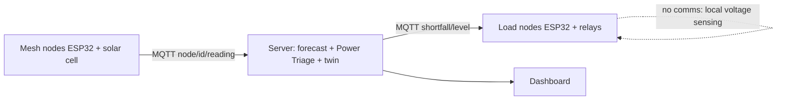

# CloudShield Grid

Cloud-Edge Mesh + Power Triage + Digital Twin for the Yuva Yodha Energy Tech Hackathon (Grid track).

Cheap solar-cell sensors detect a passing cloud edge and forecast when and how deep the solar dip will hit. Power Triage uses the forecast to throttle heavy loads fairly and protect critical homes, so a dip becomes a brownout instead of a blackout.


## What is in the repo

| Path | What it does |
|---|---|
| `twin/` | Digital twin: moving cloud field, 100 simulated homes, mesh sensing, plane-wave forecast, Power Triage, no-mesh baseline |
| `ai/` | Gradient-boosting refiner that corrects the forecast dip depth, trained on twin data |
| `server/` | FastAPI backend: runs the twin live, bridges MQTT hardware nodes, exposes `/api/state`, `/api/status`, `/api/replay` |
| `dashboard/` | Self-contained dashboard with the twin running in the browser (see below) |
| `firmware/` | ESP32 sketches for the mesh node and the load node |
| `tests/` | Checks that CloudShield beats the baseline and the forecast is useful |

## Architecture



Three layers of resilience: predictive (mesh forecast), reactive (delayed DISCOM signal), comms-free (local voltage sensing on each load node).

## Quick start

```bash
pip install -r requirements.txt
python -m pytest -q                              # tests
python -m ai.refiner                             # train the AI refiner (saves models/refiner.joblib)
python -m twin.run --ai --seed 2                 # run one scenario, print metrics
uvicorn server.app:app --reload                  # dashboard at http://localhost:8000
```

With hardware: `docker compose up` starts the app plus a Mosquitto broker. Flash `firmware/mesh_node` (set `ID` to `mesh-0` ... `mesh-4`) and `firmware/load_node`, set the broker IP, and the dashboard marks those nodes as `hardware`. Mesh readings from real nodes replace the simulated ones automatically.

## Deployment status for judges

- **Live mode:** the status panel shows the active layer, AI state, MQTT connection, uptime and per-node source (`hardware` or `simulated`).
- **Static mode:** every push to `main` runs the tests and deploys the dashboard to GitHub Pages, fully interactive. Enable it under Settings > Pages > Source: GitHub Actions.

## Dashboard

`dashboard/index.html` is one self-contained file. The digital twin runs in the browser, so it works on GitHub Pages, from a local server, or by double-clicking the file, with no backend required.

- **Digital-twin map:** moving cloud shadow, 100 homes (50 or 200 selectable), mesh nodes, solar plant, forecast bubble.
- **Power Triage panel, KPIs, three charts, event log,** all compared against a no-mesh baseline (use "View: Baseline" to see the same event without CloudShield).
- **Scenario controls:** presets, cloud speed, depth and length, pause, speed up to 20x, loop, and a scrubber to review any moment.
- **Fault injection:** comms failure (local voltage fallback), mesh forecast off, AI refiner on/off, kill any mesh sensor.
- **AI panel:** geometric versus AI-refined dip depth against the simulation ground truth. The gradient-boosting model is embedded in the page.
- **Prototype bench:** load nodes (homes, pump with tank safety floor, cold box with temperature band).
- **Hardware:** "Connect mesh node (USB)" uses Web Serial (Chrome or Edge) with `firmware/mesh_node` set to `USB_ONLY 1`. With the backend and a broker running, MQTT nodes appear automatically. Fresh hardware readings replace the simulated sensor and the node is marked `hardware`.
- **Deployment status:** twin, backend, MQTT, USB, AI model, hardware node count, build and uptime.
- **Export:** CSV of the run, a JSON report, and a copyable one-line summary.

To retrain the embedded AI model: `python -m ai.refiner` then `python -m tools.embed_ai`.

## AI and digital twin

- **Forecast:** a least-squares plane-wave fit over cloud crossing times gives speed, direction, ETA and depth.
- **AI refiner:** gradient boosting corrects the dip depth. `python -m ai.refiner` prints geometric versus refined error on held-out twin data. ETA refinement was tested and gave no gain, so ETA stays geometric.
- **Twin:** runs the same forecast and triage code as the live system, so hardware and simulation share MQTT topics.

## Honest limits

- All twin results are on synthetic data with model assumptions (supply mix, load profiles, 5 s DISCOM delay, 2 s protection delay, 15 s trip). They are not field measurements.
- Lead time is seconds to a few minutes, set by sensor spacing and cloud speed.
- The mesh nodes need tight time sync; the prototype uses server arrival time over a LAN, and a field design would use GPS PPS.
- The demo should run on 12V DC only. A field design needs mains-rated sensors and contactors, and DISCOM consent.

## Push to GitHub

```bash
git init && git add . && git commit -m "CloudShield Grid"
gh repo create cloudshield-grid --public --source=. --push
```
